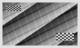

# R045 交接单（三格位 / 单声道 WAV）

离线复核，不需要母带或服务端。机器地址见 [`addresses.json`](addresses.json)，
可读地址表见 [`addresses.md`](addresses.md)。

## 结论

1. **冻帧没有同一个源格跨过无图段。** 格位 2、3 像素和 PNG 哈希相同，但地址清单给出不同源格；中间是 `5000000..6000000` μs 无图段。
2. **无图段两边伴音均在源 PCM 覆盖内。** 核对 `L-BEFORE` 与 `R-AFTER`。
3. WAV 中实录零声标为 `recorded_silence`；摘片补零标为 `extract_fill` / `filled_zero_sample_ranges`，不能只凭“听起来是零”判断。

## 三个格位

### 格位 1：跨两个目标点的同一长格

- 文件：`frames/slot-1.png`
- 唯一源格：`V08-03500ms`
- 源覆盖：`3500000..4500000` μs
- 目标 `T-L1` @ `3700000` → `V08-03500ms`
- 目标 `T-L2` @ `4200000` → `V08-03500ms`

### 格位 2：无图段前最后源格（孪生像素）

- 文件：`frames/slot-2.png`
- 唯一源格：`V09-04500ms`
- 源覆盖：`4500000..5000000` μs
- 目标 `T-B0` @ `4750000` → `V09-04500ms`

### 格位 3：无图段后第一源格（另一源格）

- 文件：`frames/slot-3.png`
- 唯一源格：`V10-06000ms`
- 源覆盖：`6000000..6500000` μs
- 目标 `T-A0` @ `6250000` → `V10-06000ms`

## 唯一 WAV

[`audio/R045-primary-mono.wav`](audio/R045-primary-mono.wav)

- mono / 8000 Hz / 16-bit
- 绝对源采样：`[35200,60800)`
- 自检：`python3 verify_handoff.py .`
- 校验和：`sha256sum -c SHA256SUMS`
